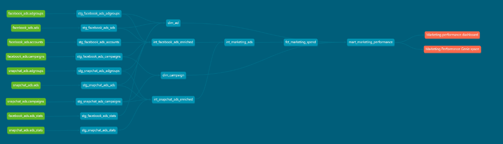

# Evidence

Test records for the claims made about the Marketing Data Platform.

| Folder | What it shows |
|---|---|
| `lineage/` | The lineage graph from the generated dbt docs |
| `genie/` | An AI agent answering marketing questions from the model, checked against the raw data |
| `elementary/` | Elementary observability catching a schema change |

## Lineage

| File | Contents |
|---|---|
| `lineage/lineage_graph_full.png` | Lineage graph from the generated dbt docs, from raw sources to the two consumers |

## Genie test

The final model, `mart_marketing_performance`, was put behind a Databricks Genie space to
test whether an AI agent can answer marketing questions correctly from the model's names
and documentation alone.

| File | Contents |
|---|---|
| `genie/genie_test_01_initial_run.pdf` | First run: three questions and Genie's answers |
| `genie/genie_test_02_after_instruction_fix.pdf` | Retest after adding an instruction on like-for-like comparisons |
| `genie/genie_ground_truth_check.md` | Each answer checked against figures recomputed from the raw CSV files |

### How the test was run

1. The table and column descriptions from dbt were stored with the table in Unity Catalog.
2. A Genie space was created over `mart_marketing_performance` only, with instructions
   stating the rules consumers must follow (group spend by currency, null means unknown,
   recompute ratios from sums).
3. Three questions were asked: Facebook spend in December 2025, the campaign with the most
   clicks, and a Facebook versus Snapchat spend comparison.
4. Each answer was checked against figures calculated directly from the raw files.

### Result

All figures matched the raw data. The one weakness is how the platform comparison is
worded, which is recorded in the ground truth file.

## Elementary observability

Elementary records every dbt test result and run in tables, and its report shows them over time.
A schema change test was added to the two staging stats models, the fact and the mart.
The full report is at `docs/elementary_report.html`.

| File | Contents |
|---|---|
| `elementary/elementary_01_dashboard_baseline.png` | Report dashboard before the demo, all tests healthy except two expected warnings |
| `elementary/elementary_02_schema_change_added_terminal.png` | dbt output when a demo column was added to `stg_facebook_ads_stats` |
| `elementary/elementary_03_schema_change_added_report.png` | The same detection shown in the Elementary report |
| `elementary/elementary_04_schema_change_removed.png` | Detection after removing the demo column |
| `elementary/elementary_05_dashboard_after_revert.png` | Report after the model returned to its original columns |

The demo column was added and removed in the dev schema only. It was never committed.